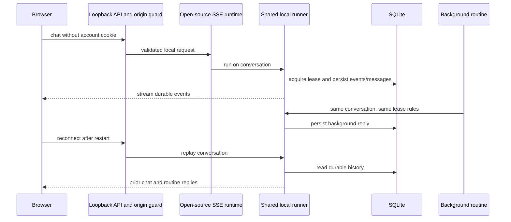

# Free-bot review context

## Intent

Run CopilotKit OpenBot locally without platform sign-in, a project key, or a license token. Preserve durable chats and the shared execution path for browser turns, routines, and handoffs. Keep model-provider credentials and optional external integrations separate.

The first review unit is the local runtime, configuration, request boundary, and startup. The second is the desktop source launcher and its isolated installation profile. Publishing signed desktop installers is outside this change.

## System behavior

Upstream requires Intelligence for conversation execution and storage. Local mode selects the open-source SSE runtime and a SQLite-backed runner. PostgreSQL continues to own the existing agents, settings, routines, permissions, and local memory. Configurations that explicitly select Intelligence keep their original service contract.

Critical paths include single-thread exclusion, exact-run cancellation, restart persistence, tool-call history conversion, and protecting model-only handoff instructions from transcript storage. Failed or stopped runs retain partial visible messages. Local mode requires one local administrator and loopback addresses; Host and Origin checks run before HTTP routes and WebSocket upgrades. A separate opt-in callback listener serves only the existing authenticated tool/model routes to container agents; it refuses browser origins and every ordinary API route.

## Decisions

| Decision | Reason |
| --- | --- |
| Use the SDK's SSE execution mode | Runs the open-source path without emulating a licensed platform. |
| Own durable SQLite storage | Avoids the process-global, evictable in-memory SDK store. |
| Share one runner/client per data path | Browser and background work see the same messages and exclusion state. |
| Preserve native and wire tool-call shapes at their boundary | The SDK runner and the existing headless toolkit consume different history contracts. |
| Keep canonical persisted messages when IDs match model input | Handoffs may show a summary while sending the model a longer instruction with the same ID. |
| Keep local mode single-user | The SDK's local thread endpoints do not carry per-user authorization. |
| Isolate fork data and ports | Existing source clones, profiles, and live databases stay untouched. |

## Verification

| Check | Result |
| --- | --- |
| `bun run test:local` | 23 passed; persistence, tool history, contention, cancellation, failure, safe headless transcripts, configuration, Origin/Host protection. |
| Focused existing config, chat, single-user, thread, and authentication tests | 233 passed. |
| `bun test scripts/start-restart-guard.test.ts app/tests/serve.test.ts` | 69 startup and production-app checks passed, including SSE metadata without a license field and local loopback serving. |
| Tenant-package tests against disposable migrated PostgreSQL | 58 passed. |
| `bun run --cwd server typecheck` | Passed. |
| Desktop setup UI, TypeScript, Vite build, and native binary compilation | Passed; 101 UI tests. |
| Native environment and source-copy tests | 67 environment and 2 copier tests passed. |
| Changed-file Biome and `git diff --check` | Passed. |
| Compose configuration using `.env.example` | Passed. |
| `bun --no-env-file scripts/free-bot-e2e.ts` | 15 acceptance steps passed against the actual server, fake local model, and real Chrome. |

The final end-to-end record is `.free-bot/verification/1793296727733-1d053b3a/report.json`. Its screenshot visibly contains the original chat, second turn, background routine, and browser-created message after reload. No browser errors were recorded. All fixture processes, the database container, and temporary home/data were removed. No live model credentials or application data were used.

## Operational confidence

| Plane | Evidence and limits |
| --- | --- |
| Observability | Existing server logs and routine-run records report success/failure. The fixture retains request logs, screenshots, and JSON evidence. No new metrics service is introduced. |
| Control | `OPENBOT_RUNTIME` selects local or explicitly configured Intelligence mode. Local mode rejects multi-user and public origins. Stop targets the current or specified run. |
| Recovery | Original clones are unchanged. Preserve both SQLite data and the PostgreSQL volume when backing up. A crash can retain a lease for up to 120 seconds. |
| Troubleshooting | Inspect the local server log and routine-run records. `FREE_BOT_DATA_DIR` identifies the conversation store; fixture logs identify every test process. |

## Reviewer attention

Independent review found and verified fixes for same-ID handoff instruction leakage, cross-site conversation deletion, and the startup probe's assumption that SSE reports a license status. The final independent review has no blocking findings. It also verified the desktop local default, private profile, source-copy symlink protection and retained license, callback port allocation, production app loopback binding, and authenticated Docker callbacks.

Long-history performance is unbenchmarked. Local mode is a single-process, single-user deployment; it does not provide replica coordination or hosted Intelligence Learning. Optional integrations still need their own service credentials. A full native application launch has not been run, and a signed desktop release has not been published.
